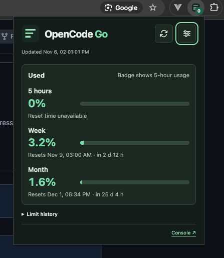

# OpenCode Go Meter

**English** · [Русский](README.ru.md)

A Chrome extension for **OpenCode 2.0 (v2)** that tracks your OpenCode Go subscription limits. Pin it to see your 5-hour quota on the toolbar, or open the popup for all three usage windows and their reset times.



## Features

- **Toolbar badge** shows the 5-hour quota. Choose between usage and remaining quota in settings. The same choice applies to the badge and the popup.
- **Quota overview** shows the 5-hour, weekly, and monthly limits with reset times and countdowns. If your account has multiple workspaces, select one in the popup.
- **Background refresh** runs about every 2 minutes by default. Choose a different interval in settings or refresh manually from the popup.
- **Notifications** can alert you at 75%, 90%, and 100% usage. Select the thresholds you want and send a test notification from settings.
- **Local history** shows up to 7 days of readings collected after installation. The daily totals and hourly heatmap estimate usage from changes in the monthly quota between readings.
- **Language and theme** can follow Chrome and your system. You can also choose English or Russian, and light or dark mode.

## Requirements

- Chrome 120 or later.
- An active OpenCode Go subscription and an OpenCode Console session in the same Chrome profile. [OpenCode Console](https://opencode.ai/console)

## Install in Chrome

1. Download and extract the repository, or clone it locally.
2. Sign in to OpenCode Console in the Chrome profile where you want to use the extension.
3. Open `chrome://extensions` and turn on **Developer mode**.
4. Click **Load unpacked** and select the `extension` folder.
5. Open Chrome's **Extensions** menu and pin **OpenCode Go Meter**.

After updating the local files, open `chrome://extensions` and click the reload icon on the extension's card. If the toolbar badge shows `!`, open the popup to see the reason and the last successful reading, when available.

## Data and privacy

The extension uses your existing OpenCode Console browser session. It sends requests to `/console/api/orgs` and `/console/api/go/status` on `opencode.ai`. Signing in to Console is sufficient for authentication. Settings and quota history are stored locally in Chrome.

## Development

Load the `extension` folder directly in Chrome. Run the tests from the project root with Node.js.

```sh
node --test
```

## License

[MIT License](LICENSE). Copyright © 2026 Eugeny Nosenko.
