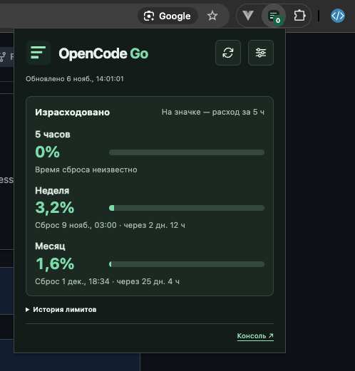

# OpenCode Go Meter

[English](README.md) · **Русский**

Расширение для Chrome и **OpenCode 2.0 (v2)**, которое показывает лимиты подписки OpenCode Go. Закрепите значок, чтобы видеть пятичасовой лимит прямо на панели браузера. В окне расширения доступны все три лимита и время их сброса.



## Возможности

- **Значок на панели** показывает пятичасовой лимит. В настройках можно выбрать расход или остаток. Выбранный режим применяется к значку и окну расширения.
- **Лимиты** за 5 часов, неделю и месяц с датой и обратным отсчётом до сброса. Если в аккаунте несколько рабочих пространств, нужное можно выбрать в окне расширения.
- **Фоновое обновление** примерно раз в 2 минуты по умолчанию. Интервал можно изменить в настройках. Для немедленного обновления есть кнопка в окне расширения.
- **Уведомления** при достижении 75%, 90% и 100% расхода. В настройках можно выбрать пороги и отправить тестовое уведомление.
- **Локальная история** хранит до 7 дней замеров, собранных после установки. Расход по дням и тепловая карта по часам рассчитываются по изменениям месячной квоты между замерами.
- **Язык и тема** могут подстраиваться под Chrome и систему. Можно вручную выбрать русский или английский язык, светлую или тёмную тему.

## Требования

- Chrome 120 или новее.
- Активная подписка OpenCode Go и вход в OpenCode Console в том же профиле Chrome. [OpenCode Console](https://opencode.ai/console)

## Установка в Chrome

1. Скачайте и распакуйте репозиторий или клонируйте его на компьютер.
2. Войдите в OpenCode Console в профиле Chrome, в котором будете пользоваться расширением.
3. Откройте `chrome://extensions` и включите **Режим разработчика**.
4. Нажмите **Загрузить распакованное расширение** и выберите папку `extension`.
5. Откройте меню **Расширения** и закрепите **OpenCode Go Meter**.

После обновления файлов откройте `chrome://extensions` и нажмите значок перезагрузки на карточке расширения. Если на панели появился `!`, откройте окно расширения. В нём будет указана причина и, если есть сохранённые данные, время последнего успешного замера.

## Данные и конфиденциальность

Расширение использует текущую браузерную сессию OpenCode Console. Оно запрашивает `/console/api/orgs` и `/console/api/go/status` на `opencode.ai`. Для авторизации достаточно войти в Console. Настройки и история лимитов хранятся локально в Chrome.

## Разработка

Папку `extension` можно загрузить напрямую в Chrome. Чтобы запустить тесты, выполните команду из корня проекта с установленным Node.js.

```sh
node --test
```

## Лицензия

[Лицензия MIT](LICENSE). Copyright © 2026 Eugeny Nosenko.
